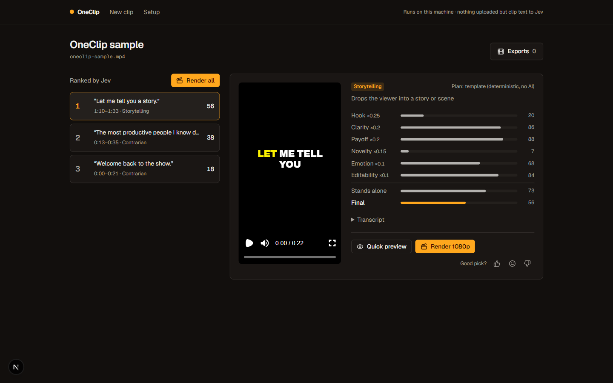

# OneClip

OneClip is an open-source AI video clipper powered by [One](https://withone.ai), TypeSafe Jev and AI editing agents. It finds the strongest hooks in a long video and turns them into short vertical clips, on your own computer.

- **Local first.** Transcription, cutting, captions and rendering all run on your machine. The only thing that leaves it is clip text sent to Jev for scoring.
- **Ranked by Jev, not by vibes.** Every candidate clip gets six scored dimensions, a context check and a hook type from TypeSafe's Jev, and the ranking explains itself.
- **Real files out.** You get playable 1080×1920, 30 fps MP4s with word-by-word captions, ready to post.



> **One is required, not a sponsor link.** OneClip calls TypeSafe's Jev through the [One CLI](https://withone.ai). One holds your TypeSafe connection and credentials; OneClip never sees or stores an API key.

## Contents

[How it works](#how-it-works) · [Requirements](#requirements) · [Quick start](#quick-start) · [Using the app](#using-the-app) · [Command line](#command-line) · [How Jev ranks hooks](#how-jev-ranks-hooks) · [Editing plans](#how-editing-plans-are-made) · [Rendering](#rendering) · [Costs](#costs-and-external-services) · [Privacy](#privacy) · [Troubleshooting](#troubleshooting) · [Roadmap](#roadmap) · [Licence](#licence)

## How it works


| Part | Where | What it does |
|---|---|---|
| `apps/web` | Next.js App Router, Tailwind, Remotion Player | The five screens: Setup, Video input, Processing, Hook results, Exports |
| `workers/media` | Node process | Claims jobs from SQLite and runs the pipeline; resumes after a restart |
| `packages/core` | TypeScript | One client, Jev questions and ranking, transcription, segmentation, plans, FFmpeg renderer, SQLite (Drizzle) |
| `packages/remotion` | Remotion | Three templates (`podcast-short`, `educational-short`, `storytelling-short`) with three caption styles |
| `python/transcribe.py` | Python | faster-whisper with word timestamps (optional; there is an ONNX fallback in Node) |
| `datasets/` | JSON | Synthetic hook examples and evaluation cases for `pnpm eval:hooks` |

## Requirements

| Need | Version | Notes |
|---|---|---|
| Node.js | 22.13 or newer | Tested on Node 26 |
| pnpm | 10 | `corepack enable` installs the pinned version |
| FFmpeg + FFprobe | 6 or newer, with libass | libass is only needed for the FFmpeg renderer's captions. On Windows, the gyan.dev "full" build has it |
| One CLI | 2.x | `npm i -g @withone/cli`, then a free One account |
| A TypeSafe account | — | Connected in One with `one add typesafe` |
| Python | 3.10 to 3.12 (optional) | For faster-whisper. Without it, OneClip uses Whisper on ONNX Runtime (CPU) |
| OpenRouter (optional) | — | For AI edit plans with cheap models: `one add open-router`. Claude Code or OpenCode also work. Without any of them, the built-in template planner is used |
| Disk | ~1 GB free | Whisper model, Chrome Headless Shell (~131 MB, downloaded on the first Remotion render), renders |

No GPU is needed. Everything was tested on Windows 11 on CPU; macOS and Linux use the same code paths but haven't been run end to end yet ([help wanted](CONTRIBUTING.md)).

## Quick start

```bash
git clone https://github.com/janmm97/oneclip.git
cd oneclip
corepack enable
pnpm install

# One account + TypeSafe (once)
npm i -g @withone/cli
one init          # sign up or sign in at https://withone.ai
one add typesafe  # connect your TypeSafe account
one add open-router  # optional: AI edit plans with cheap models

pnpm run setup    # checks One → TypeSafe → Jev, installs faster-whisper if Python is there, downloads the model
pnpm run doctor   # every check in one list; add --test-jev for one live call (~300 tokens)
pnpm dev          # web app on http://127.0.0.1:3000 plus the media worker
```

Use `pnpm run setup` and `pnpm run doctor`, not `pnpm setup` / `pnpm doctor`: those two names are pnpm's own built-in commands.

Want to try it without your own footage? `pnpm sample` makes a synthetic test video with speech, and `pnpm e2e` runs the whole pipeline on it.

## Using the app

1. **Setup** shows the same checks as `pnpm run doctor`, with the exact fix for anything red. "Test Jev live" sends one small request.
2. **New clip.** Paste a YouTube link if you like (OneClip only reads its title and thumbnail through YouTube's public oEmbed endpoint; it never downloads from YouTube). Then give the full path to the video file on your computer, and tick that you own it or are authorised to edit it. Pick the clip length, how many clips to keep, the renderer and the edit planner.
3. **Processing** shows each stage live: probe, audio, transcribe, candidates, Jev, plan. You can close the tab; the worker keeps going and resumes after a restart.
4. **Hook results** lists the clips ranked by Jev. Pick one to see a live caption preview, the hook type, every score with its weight, any penalties and the transcript. Choose "Quick preview" (fast, low resolution) or "Render 1080p", and rate the pick good, average or bad. Ratings stay on your machine and feed `pnpm eval:hooks --feedback`.
5. **Exports** plays every finished MP4, with a download link for each and "Download all (zip)".

## Command line

| Command | What it does |
|---|---|
| `pnpm run setup [--skip-python] [--model base]` | First-run setup (see above) |
| `pnpm run doctor [--test-jev]` | Checks Node, FFmpeg, libass, One, TypeSafe, Jev, transcription, editing agent, Remotion |
| `pnpm clip <video> [--preset standard] [--top 5] [--candidates 24] [--planner auto] [--renderer remotion] [--quality final] [--no-render]` | The whole pipeline without the UI |
| `pnpm eval:hooks [--dry] [--feedback] [--json]` | Runs Jev over `datasets/` and reports precision@K, ranking agreement, strong-hook recall and false-positive rate |
| `pnpm sample` / `pnpm e2e [--renderer remotion]` | Synthetic test video / full run on it |
| `pnpm test` · `pnpm lint` · `pnpm build` | Unit and integration tests · type checks · production build |

Optional settings are in [`.env.example`](.env.example) (data folder, Python path, binary paths, Jev model, concurrency, OpenRouter models). None of them is a secret.

## How Jev ranks hooks

For each candidate clip, OneClip sends **one** request to Jev (TypeSafe's "Answer questions using Systemone" action) through `one actions execute`. It asks eight questions about the clip text:

| Question | Jev answer type | Weight |
|---|---|---|
| Hook strength: does the opening make you keep watching? | Score | 0.25 |
| Standalone clarity: does it make sense without the rest? | Score | 0.20 |
| Narrative payoff: does it deliver what the hook promised? | Score | 0.20 |
| Novelty | Score | 0.15 |
| Emotional engagement | Score | 0.10 |
| Editing suitability | Score | 0.10 |
| Context integrity: is it a complete thought? | Noul (0 to 1) | gate |
| Hook type (curiosity gap, bold claim, contrarian, storytelling, …) | Choice | label |

The final score is the weighted sum, then:

- ×0.5 if context integrity is below 0.5 (the clip depends on something outside it);
- ×0.8 if standalone clarity is below 0.35;
- ×0.9 if there's no recognisable hook and hook strength is below 0.5.

Clips that overlap a better clip by more than half, or repeat its text, are dropped, and the top N are kept. Answers are validated with Zod and cached in SQLite, so re-running a project costs nothing.

**Measured on the bundled datasets** (29 live Jev calls, 2026-11-24): precision@2 83%, ranking agreement 100%, strong-hook recall 100%, false-positive rate 0%. The datasets are small and synthetic; treat these as a smoke test, not a benchmark.

## How editing plans are made

The planner turns a ranked clip into an `EditPlan`: template, layout, crop, caption style, emphasis words, title card, transitions. The planner only chooses within fixed options; OneClip fills in the timings and checks the whole plan with Zod before rendering.

| Planner | How |
|---|---|
| `openrouter` | One chat completion per clip through `one actions execute open-router …`, on cheap models with JSON output: `deepseek/deepseek-v4-flash`, then `tencent/hy4-flash`, then `openai/gpt-6-luna` if one is down (change them with `ONECLIP_OPENROUTER_MODELS`). No tools are sent, so the model can only return text |
| `claude-code` | Runs `claude -p` with a JSON schema for the answer, all tools turned off, no MCP servers and no saved session |
| `opencode` | Runs `opencode run` with the clip on stdin, every tool and permission denied and an empty working folder, and reads the first JSON object from the reply |
| `template` | Deterministic rules, no AI, always available |
| `auto` (default) | OpenRouter via One, then Claude Code, then OpenCode, then template |

If an agent's output doesn't validate, OneClip falls back to the template planner and shows why in the results.

## Rendering

- **Remotion** (default): animated word-by-word captions, title card and the three templates, rendered headless with Chrome Headless Shell (downloaded once, ~131 MB). Measured: about 107 s for a 46 s clip at 1080×1920 on CPU.
- **FFmpeg**: faster and lighter. Captions are burned in with ASS/libass. Use it on slower machines or if Chrome can't be downloaded.

Every render is checked with FFprobe (size, duration, H.264 video, an audio track and audio/video drift). If the chosen renderer fails or its output doesn't pass the check, OneClip retries the clip with the FFmpeg renderer.

## Costs and external services

| Service | Used for | Cost |
|---|---|---|
| [One](https://withone.ai) | Runs the TypeSafe and OpenRouter actions and holds your credentials | See One's pricing |
| TypeSafe Jev | Scoring clips | About **1,400 tokens per candidate clip** on your TypeSafe account. The default 24 candidates ≈ 34k tokens per video. `pnpm run doctor --test-jev` ≈ 300 tokens. `pnpm eval:hooks` ≈ 41k tokens. Cached answers are free |
| OpenRouter (optional) | Edit plans | One request per kept clip (about 4k characters in) on your OpenRouter account. Measured with `deepseek/deepseek-v4-flash`: **$0.0001 to $0.0006 per clip** (6 plans, average $0.0003), so about $0.002 for the default 5 clips |
| Claude Code / OpenCode (optional) | Edit plans | One short prompt per clip on your own plan or API key |
| YouTube oEmbed | Title and thumbnail | Free, no key |
| Remotion | Rendering | Free for individuals and small companies; larger companies need a [Remotion company licence](https://www.remotion.dev/license) |

## Privacy

- Your video, audio and renders never leave your machine.
- Clip **text** (transcript excerpts) goes to TypeSafe through One for scoring, and to OpenRouter through One (or Claude Code or OpenCode) for edit plans. Pick the `template` planner to keep it off every AI service except TypeSafe.
- Nothing is uploaded to YouTube or anywhere else. There is no telemetry.
- The web app listens on 127.0.0.1 only and rejects requests with another Host or Origin.
- Projects, transcripts and the database live in `./.oneclip` (git-ignored). Delete that folder to delete everything.

Only process videos you own or are authorised to edit.

## Troubleshooting

| Symptom | Fix |
|---|---|
| `pnpm setup` does something unexpected | Use `pnpm run setup`; `setup` and `doctor` are pnpm built-ins |
| "One CLI not found" | `npm i -g @withone/cli`, or set `ONE_BIN` |
| "TypeSafe not connected" | `one add typesafe`; if you have several, set `ONE_TYPESAFE_KEY` |
| faster-whisper won't install or crashes | It needs Python 3.10–3.12. OneClip falls back to ONNX Whisper automatically. On Windows 11 with **Smart App Control** on, unsigned native Python wheels can be blocked; the ONNX fallback still works |
| ONNX transcripts are weaker | The ONNX fallback is a lighter path: it uses Whisper small for every model setting (medium and large-v3 included), transcribes in 30 s windows, and assumes English when the language is auto. Set the language explicitly for other languages, or install faster-whisper for best results |
| FFmpeg captions missing | Your FFmpeg has no libass; install a full build, or use the Remotion renderer |
| First Remotion render is slow | It downloads Chrome Headless Shell once (~131 MB) |
| "No complete thoughts fit this clip length" | Pick a shorter preset; very short or music-only videos have few complete sentences |
| A render failed | The results screen shows the error; "Render 1080p" again retries. Try the FFmpeg renderer |

## Roadmap

- Speaker-aware cropping (face tracking) for two-person podcasts
- More caption styles and brand colours per project
- macOS and Linux end-to-end runs in CI
- Batch mode across a folder of videos

Ideas and bugs: [open an issue](https://github.com/janmm97/oneclip/issues).

## Contributing

See [CONTRIBUTING.md](CONTRIBUTING.md). In short: `pnpm install`, `pnpm lint && pnpm test`, small PRs with Conventional Commit messages. Security issues: see [SECURITY.md](SECURITY.md).

## Licence

OneClip's own code is [MIT](LICENSE). Its dependencies keep their own licences: notably **Remotion**, which is free for individuals and companies of up to three people and needs a paid company licence beyond that (see [remotion.dev/license](https://www.remotion.dev/license)); faster-whisper (MIT); Whisper model weights (MIT, by OpenAI); FFmpeg (LGPL/GPL, installed separately, not bundled). If Remotion's licence doesn't fit you, use the FFmpeg renderer, which has no Remotion dependency at render time.
