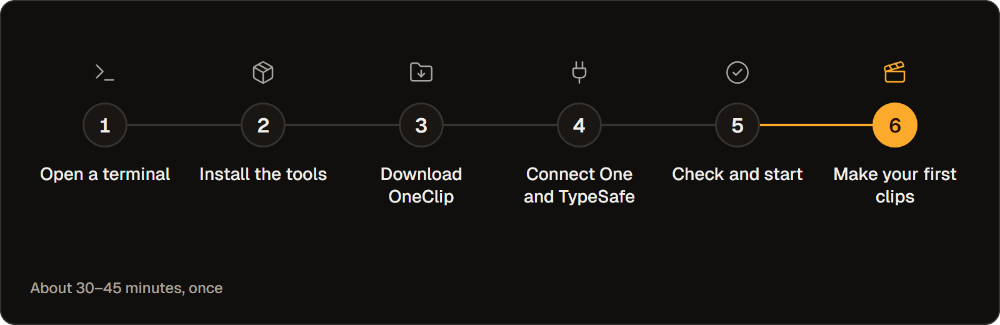
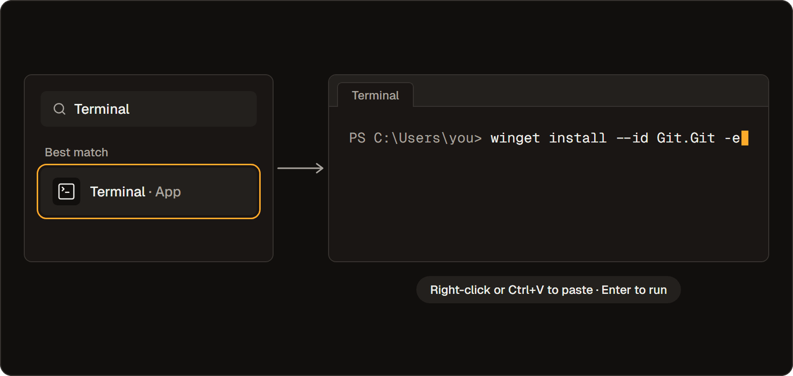
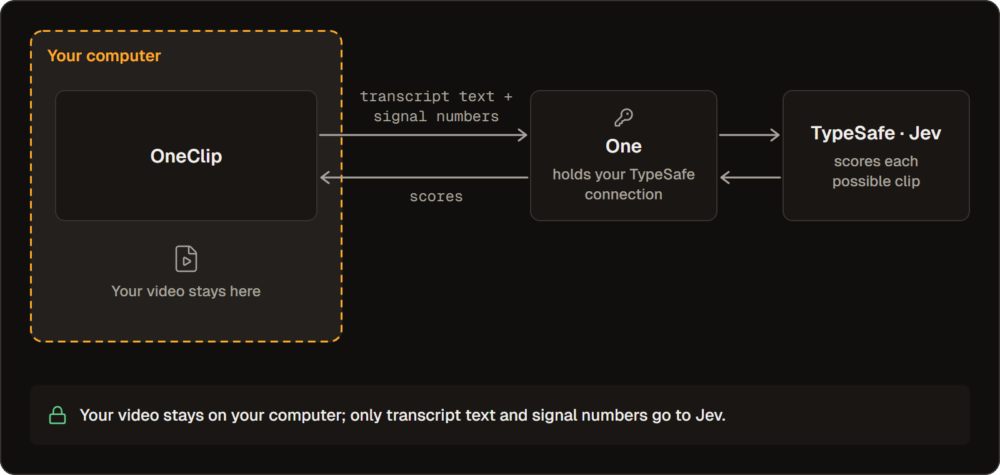
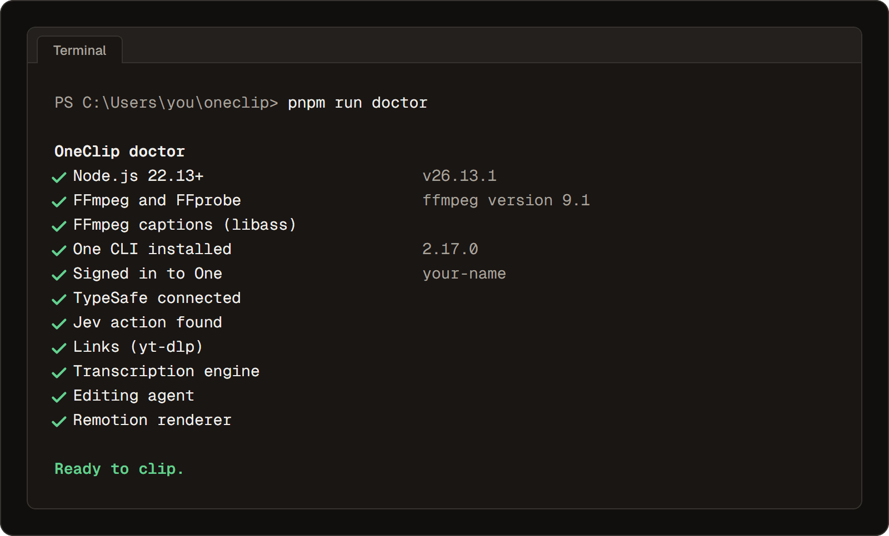
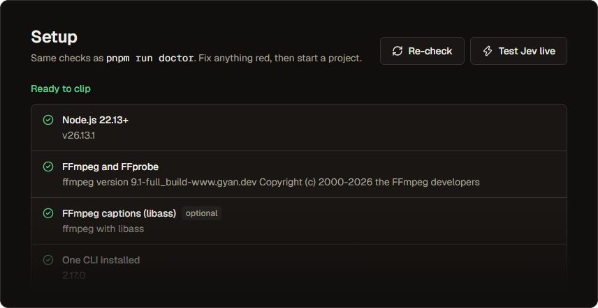
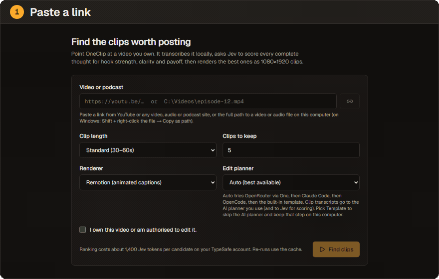
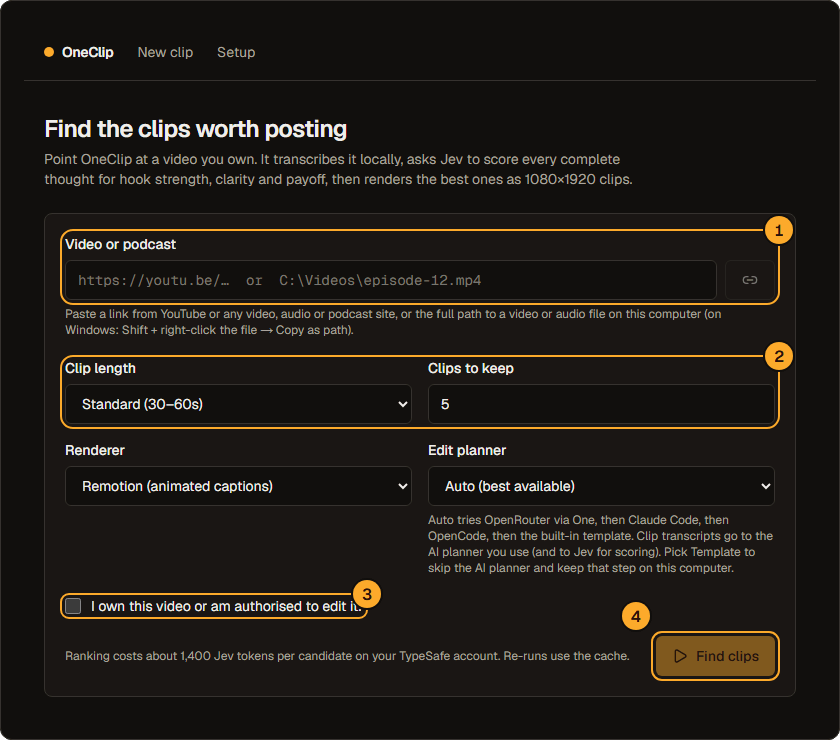
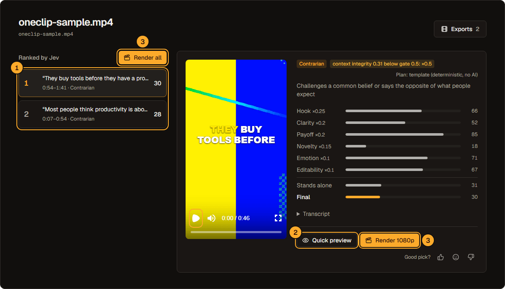
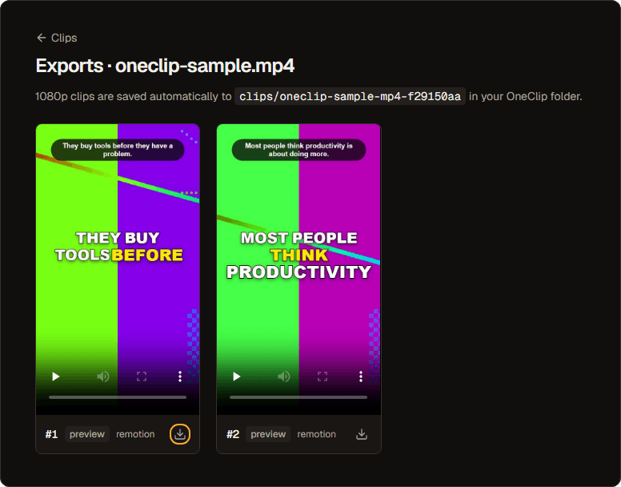
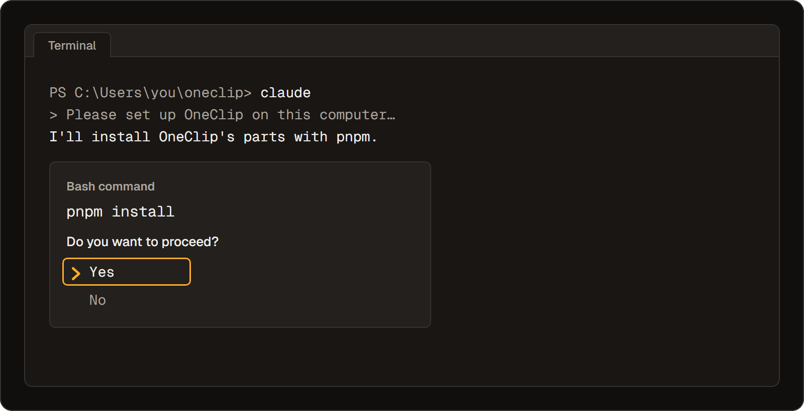

# Getting started with OneClip (no experience needed)

This guide takes you from a brand-new computer to your first finished clips. You don't need to know how to code, and you don't need to have used Claude Code, One or a terminal before. Every step tells you what to type, what you should see, and what to do if it goes wrong.



| | |
|---|---|
| **Time** | About 30–45 minutes the first time. After that, starting OneClip takes two short commands. |
| **Computer** | Windows 10 or 11 (tested). Mac and Linux should work with the Mac commands shown, but haven't been fully tested yet. No special graphics card needed. About 3 GB of free disk space. |
| **Accounts** | A free [One](https://withone.ai) account and a TypeSafe account (you create it while connecting, in Step 4). |
| **Cost** | OneClip is free. Scoring clips uses TypeSafe tokens (TypeSafe's unit of usage): about 34,000 per video with the default settings. Check your TypeSafe plan for what that costs you. Claude Code is optional and needs a paid Claude plan. |

**Contents:** [1. Open a terminal](#step-1-open-a-terminal) · [2. Install the tools](#step-2-install-the-tools) · [3. Download OneClip](#step-3-download-oneclip) · [4. Connect One and TypeSafe](#step-4-connect-one-and-typesafe) · [5. Check and start](#step-5-check-everything-and-start-oneclip) · [6. Make your first clips](#step-6-make-your-first-clips) · [Every day after that](#every-day-after-that) · [Optional: let Claude Code set it up for you](#optional-let-claude-code-set-it-up-for-you) · [If something goes wrong](#if-something-goes-wrong) · [Words used in this guide](#words-used-in-this-guide)

---

## Step 1. Open a terminal

A **terminal** is a window where you type commands instead of clicking. You'll use it to install OneClip and to start it. You only ever need to copy a line from this guide, paste it, and press **Enter**.



**Windows**
1. Click **Start**, type `Terminal`, and press **Enter**. (On Windows 10 it may be called **Windows PowerShell**: that works too.)
2. To paste a command: copy it from this page, then **right-click** inside the terminal window (or press **Ctrl+V**). Press **Enter** to run it.

**Mac**
1. Press **Cmd+Space**, type `Terminal`, and press **Enter**.
2. To paste: **Cmd+V**, then **Enter**.

> **Good to know**
> - The shaded boxes below are commands. Hover over one and click the copy button in its top-right corner, or select the whole line and copy it.
> - Some commands take a minute and print a lot of text. Wait until the terminal shows its prompt again (the line ending in `>` on Windows, or `%` on a Mac) before pasting the next one.
> - A `#` starts a note: everything after it is for you to read, and the terminal ignores it. It's fine if you copy it.

## Step 2. Install the tools

OneClip needs four free programs. You install them once.

| Tool | What it's for |
|---|---|
| **Git** | Downloads OneClip and its updates |
| **Node.js** | Runs OneClip |
| **FFmpeg** | Cuts and renders the video |
| **Python** | Downloads videos from YouTube and other links, and gives faster transcripts. Without it, only video files already on your computer work |

**Windows:** paste these four commands into the terminal, one at a time. Each one asks Windows to install a program. If a window asks "Do you want to allow this app to make changes?", click **Yes**. The first time, winget may ask you to accept its terms: type `Y` and press **Enter**.

Git:

```powershell
winget install --id Git.Git -e
```

Node.js:

```powershell
winget install --id OpenJS.NodeJS.LTS -e
```

FFmpeg:

```powershell
winget install --id Gyan.FFmpeg -e
```

Python (needed for YouTube and other links):

```powershell
winget install --id Python.Python.3.12 -e
```

**Mac:** install [Homebrew](https://brew.sh) first: copy the one command on its home page, paste it into Terminal and press **Enter**. When it asks for your Mac password, type it and press Enter. Nothing appears as you type; that's normal. Then:

```bash
brew install git node ffmpeg python@3.12 yt-dlp
```

**Now close the terminal and open a new one** (Step 1 again). New programs only show up in a fresh window.

**Check it worked.** Paste this line:

```bash
git --version; node --version; ffmpeg -version
```

✅ You should see three version numbers, something like `git version 2.56.1`, `v26.13.1` and `ffmpeg version 9.1-full_build…`. The Node number (the one starting with `v`) must be **v22.13 or higher**.

❌ If you see `is not recognized` or `command not found`: close the terminal, open a new one and try again. Still failing? Restart your computer once, then check again.

## Step 3. Download OneClip

This makes a folder called `oneclip` with everything inside it. Paste these commands one at a time.

Go to your home folder (`C:\Users\<you>` on Windows):

```bash
cd ~
```

Download OneClip:

```bash
git clone https://github.com/janmm97/oneclip.git
```

Step into the new folder:

```bash
cd oneclip
```

Install pnpm, the tool that installs OneClip's parts:

```bash
npm install -g pnpm@10
```

Install OneClip's parts (takes 1–3 minutes):

```bash
pnpm install
```

✅ The last command ends with a line like `Done in 1m 12s`. You now have the folder `C:\Users\<you>\oneclip`, where `<you>` is your own user name (on a Mac: `/Users/<you>/oneclip`).

> **Remember the folder.** From now on, every OneClip command runs **inside** the `oneclip` folder. If you open a new terminal, type `cd ~/oneclip` first.

## Step 4. Connect One and TypeSafe

OneClip asks **Jev** (an AI from TypeSafe) which moments of your video make the best clips. It talks to TypeSafe through **One**.

**What is One?** One is a free service that keeps your logins to other apps (here, TypeSafe) in one safe place. OneClip asks One to make the call, so OneClip never sees or stores a password or secret key. You connect each app once, in your browser, and you're done.



If you connect OpenRouter (Step 4d) or have Claude Code or OpenCode installed, the default **Auto** edit planner also sends each clip's text to that AI to plan the edit. To keep that step on your computer, choose **Template (no agent)** under **Edit planner** on the New clip screen.

**4a. Install One** (still in the `oneclip` folder):

```bash
npm install -g @withone/cli
```

**4b. Sign in to One:**

```bash
one init
```

1. Your browser opens on [withone.ai](https://withone.ai). **Sign up** (it's free) or sign in.
2. Go back to the terminal and answer its questions (use the arrow keys, then **Enter**). If it asks **where to save the settings**, choose **global** (for every folder). If it asks which AI agents to add the One skill to, you can skip it: OneClip doesn't need it.

Check it worked:

```bash
one whoami
```

✅ It prints your One name and email.

**4c. Connect TypeSafe:**

```bash
one add typesafe
```

Your browser opens again. Sign in to TypeSafe, or **create a TypeSafe account** when it asks, and approve the connection. Then check:

```bash
one list
```

✅ You see a line with `typesafe` in it.

**4d. Optional, most people can skip it: connect OpenRouter.** It gives AI-made edit plans for a fraction of a cent per clip. Without it, OneClip uses its free built-in planner.

```bash
one add open-router
```

## Step 5. Check everything and start OneClip

**5a. Run the setup.** It checks One, TypeSafe and Jev, sets up transcription and downloads the speech model (a few hundred MB, once):

```bash
pnpm run setup
```

> Careful: it's `pnpm run setup`, with the word `run`. Plain `pnpm setup` is a different command that belongs to pnpm itself. The same goes for `pnpm run doctor`.

**5b. Run the check-up:**

```bash
pnpm run doctor
```

✅ Every line starts with a green tick and the last line says **Ready to clip.** (Lines marked optional can show a dot instead of a tick. That's fine.)



❌ A red cross shows the fix right under it. The most common ones are in [If something goes wrong](#if-something-goes-wrong).

**5c. Start OneClip:**

```bash
pnpm dev
```

Wait until you see `Ready` and `OneClip worker ready`. Then type or paste this address into your web browser's address bar (Chrome, Edge, Safari…):

**http://127.0.0.1:3000**

> **Keep that terminal window open** while you use OneClip. Closing it stops OneClip. To stop it on purpose, click in the terminal and press **Ctrl+C**.

The **Setup** page in the app shows the same checks as `pnpm run doctor`:



## Step 6. Make your first clips



**6a. Paste a video.** Click **New clip** at the top of the page.



1. **Video or podcast:** paste a YouTube link (or a link from most video, audio and podcast sites), or the full path to a video on your computer. On Windows: hold **Shift**, right-click the file, choose **Copy as path**, and paste.
2. **Clip length** and **Clips to keep:** the defaults (30–60 seconds, 5 clips) are a good start.
3. Tick **I own this video or am authorised to edit it.** Only use videos you have the right to edit.
4. Click **Find clips**.

**6b. Wait while it works.** OneClip downloads the video, writes a transcript, measures the sound and picture, and asks Jev to score each possible clip. You can watch each stage. A 10-minute video takes a few minutes on a normal laptop. You can close the browser tab: the work carries on as long as the terminal stays open.

**6c. Pick your clips.** When it's done you see the clips ranked by Jev, best first.



1. Click a clip on the left to preview it and see why Jev scored it that way.
2. **Quick preview** makes a fast, low-quality version to check.
3. **Render 1080p** makes the final vertical video. **Render all** does every clip. The first render is slower: it downloads a small helper (~131 MB) once.

**6d. Get your files.** Click **Exports** (top right of the results page) to play and download every finished clip.



Your finished clips (the **Render 1080p** ones, not the quick previews) are also saved automatically in the **`clips`** folder inside your `oneclip` folder: one folder per video, named after the video in lowercase with dashes plus a short code, with the clips numbered in rank order (for example `clips/my-video-f29150aa/01-they-buy-tools-before.mp4`). On Windows you can open it by pasting `explorer clips` in the terminal (Mac: `open clips`).

🎉 That's it. You've made your first clips.

## Every day after that

| To… | Do this |
|---|---|
| **Start OneClip** | Open a terminal, then `cd ~/oneclip` and `pnpm dev`. Open http://127.0.0.1:3000 |
| **Stop OneClip** | Click in the terminal and press **Ctrl+C** (or close the window) |
| **Find your clips** | The `clips` folder inside `oneclip`, or the **Exports** page |
| **Update OneClip** | Stop it, then inside the `oneclip` folder run `git pull`, then `pnpm install`, then `pnpm dev` |
| **Check that everything still works** | `pnpm run doctor` |

## Optional: let Claude Code set it up for you

**Claude Code** is an AI assistant from Anthropic that works in your terminal. You type what you want in plain English, it suggests commands, and it **asks your permission before running each one**. OneClip doesn't need it, but it can walk you through Steps 2–5 and fix problems for you. OneClip can also use it to plan edits (see the note at the end of this section).

You need a paid Claude plan (Pro, Max, Team or Enterprise) or pay-as-you-go credit on an Anthropic Console account. The free claude.ai plan doesn't include Claude Code.



**1. Install Claude Code**

Windows (in the terminal from Step 1):

```powershell
irm https://claude.ai/install.ps1 | iex
```

Mac:

```bash
curl -fsSL https://claude.ai/install.sh | bash
```

Close the terminal and open a new one, then check that it worked:

```bash
claude --version
```

**2. Download OneClip.** Install Git first (Windows: `winget install --id Git.Git -e`, Mac: `brew install git`), then run only the first three commands of [Step 3](#step-3-download-oneclip) (`cd ~`, `git clone…`, `cd oneclip`). Claude Code does the rest. Then start Claude Code in that folder:

```bash
claude
```

The first time, your browser opens so you can sign in to your Claude account.

**3. Paste this message into Claude Code** and press Enter:

```text
Please set up OneClip on this computer by following docs/GETTING-STARTED.md, steps 2 to 5.
Explain each step in simple words before you do it. Stop and tell me when I need to do
something in the browser (signing up for One, connecting TypeSafe). At the end, run
pnpm run doctor and tell me if anything is not green.
```

**4. Approve each step.** Claude Code shows each command and asks before running it. Read what it says, then choose **Yes** to let it run. When it asks you to sign up for One or connect TypeSafe, do that in your browser, then tell Claude Code you're done.

When `pnpm run doctor` says **Ready to clip.**, type `/exit` to leave Claude Code and carry on from [Step 5c](#step-5-check-everything-and-start-oneclip).

> **Using Claude Code as OneClip's edit planner.** Once Claude Code is installed, the default **Auto** setting under **Edit planner** on the New clip screen can pick it (after OpenRouter, if you connected that), and you can also choose **Claude Code** yourself. It runs with every tool turned off, so it can only answer, not change anything. Clip text then goes to Claude as well as to Jev. To keep that step on your computer, choose **Template (no agent)**. Only use your own Claude account: Anthropic's terms don't allow sharing a Claude login with someone else.

## If something goes wrong

| What you see | What to do |
|---|---|
| `winget is not recognized` | Install **App Installer** from the Microsoft Store, then open a new terminal |
| `git`, `node`, `ffmpeg` or `one` `is not recognized` / `command not found` | Close the terminal and open a new one. Still there? Restart the computer once |
| `node` shows a version below 22.13 | Run `winget upgrade --id OpenJS.NodeJS.LTS -e` (Mac: `brew upgrade node`), then open a new terminal |
| `pnpm install` says `EPERM` or "operation not permitted" | Close other programs that may be using the folder (a code editor, OneDrive syncing), then run it again |
| `pnpm setup` did something strange | Use `pnpm run setup`. The same for `pnpm run doctor` |
| Doctor: **One CLI installed** is red | `npm install -g @withone/cli`, then open a new terminal |
| Doctor: **Signed in to One** is red | Run `one init` again and finish signing in |
| Doctor: **TypeSafe connected** is red | Run `one add typesafe` and approve it in the browser. Check with `one list` |
| Doctor: **Links (yt-dlp)** is red, or a link fails with "yt-dlp is needed" | Install Python (Step 2) and open a new terminal, then run `pnpm run setup`. On Windows, if typing `python` opens the Microsoft Store, install Python again with the command in Step 2 and open a new terminal. Local video files work without it |
| Doctor: **Transcription engine** says faster-whisper is missing | Nothing to do: OneClip uses its built-in transcriber instead. For better transcripts, install Python 3.12 (Step 2) and run `pnpm run setup` again |
| The browser says "This site can't be reached" | OneClip isn't running. Go to the terminal, `cd ~/oneclip`, `pnpm dev`, and wait for `Ready` |
| "No complete thoughts fit this clip length" | Pick a shorter **Clip length**: the video doesn't have enough complete sentences that fit the length you chose |
| The first **Render 1080p** is slow | Normal: it downloads a small helper (~131 MB) once. Or pick the **FFmpeg** renderer |
| A render failed | Click **Render 1080p** again, or switch **Renderer** to **FFmpeg** |

Still stuck? Run `pnpm run doctor` and copy what it prints. It contains no passwords, but it does show your One account name: you can delete that line before posting. Then [open an issue](https://github.com/janmm97/oneclip/issues).

## Words used in this guide

| Word | Meaning |
|---|---|
| **Terminal** | A window where you type commands (Windows Terminal, PowerShell, or Terminal on a Mac) |
| **Command** | One line you paste into the terminal and run with Enter |
| **Folder / `cd`** | `cd` means "change directory": it moves the terminal into a folder |
| **Path** | Where a file lives on your computer, for example `C:\Videos\episode-12.mp4` |
| **One** | A free service that holds your app connections (like TypeSafe) so OneClip never sees your passwords or keys |
| **TypeSafe / Jev** | TypeSafe is the company; Jev is its AI that scores each possible clip |
| **Token** | The unit TypeSafe uses to measure usage. About 34,000 per video with the default settings |
| **Claude Code** | Anthropic's AI assistant for the terminal. Optional: it can set OneClip up for you |
| **pnpm** | The tool that installs and starts OneClip |
| **127.0.0.1:3000** | The address of OneClip on your own computer. Nobody else can open it |

For everything else (how Jev ranks clips, settings, costs and privacy), see the [README](../README.md).
